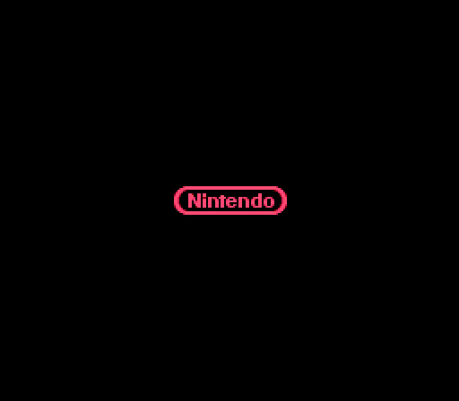

# Stunt Race FX — Static Recompilation

```
    ____  _____  _   _  _   _  _____   ____      _     ____  _____
   / ___||_   _|| | | || \ | ||_   _| |  _ \    / \   / ___|| ____|
   \___ \  | |  | | | ||  \| |  | |   | |_) |  / _ \ | |    |  _|
    ___) | | |  | |_| || |\  |  | |   |  _ <  / ___ \| |___ | |___
   |____/  |_|   \___/ |_| \_|  |_|   |_| \_\/_/   \_\\____||_____|
                          _____  __  __
                         |  ___| \ \/ /
                         | |_     \  /
                         |  _|    /  \
                         |_|     /_/\_\
```

> **Revving the Super FX chip back to life — one recompiled function at a time.**

Remember 1994? Argonaut Software and Nintendo strapped a custom RISC coprocessor onto a cartridge and said "yeah, we're doing 3D on the Super Nintendo." The result was **Stunt Race FX** — polygonal racing on a 16-bit console that had no business doing polygons. It was glorious. It was janky. It ran at approximately 4 frames per second on a good day. *We loved it.*

This project rips the original 65816 + Super FX 2 machine code out of the ROM and rebuilds it as **native C**, linked against [snesrecomp](https://github.com/sp00nznet/snesrecomp) for authentic PPU/APU/DMA hardware simulation. The CPU is us. The hardware is real. The vibes are immaculate.

---

## What it is

A **static recompilation** of Stunt Race FX (SNES, 1994) from WDC 65C816 + Super FX 2 (GSU-2) assembly into native C code, built on the [snesrecomp](https://github.com/sp00nznet/snesrecomp) toolkit and SDL2.

Each original subroutine is hand-translated into C that talks to SNES hardware (PPU, APU, DMA, GSU-2) through snesrecomp. The project follows snesrecomp's **incremental interception** model: the genuine ROM runs on a cycle-accurate CPU, and each recompiled function replaces its ROM subroutine once it is verified against genuine execution, until coverage reaches 100% native.

Follows the recomp house style shared with snesrecomp, gbarecomp, lynxrecomp,
xboxrecomp, ps3recomp and pcrecomp: the toolkit lives in its own repo, generated
code is never committed, and every build runs headless.

## Status

**Alpha. Unversioned.** What runs today, checked headless on the current build
(2026-10-20, `--headless --record`, realframe mode):

- The ROM loads, the Super FX GSU-2 is detected and initialised, and the boot
  draws the **Nintendo logo**. After that the screen stays **black** (checked
  to frame 6000). Getting past it is the top item in [ROADMAP.md](ROADMAP.md).
- **82 routines** are hand-translated to C ([docs/functions.md](docs/functions.md));
  **one** (`$0B:B4C3`, the entity allocator) is verified bit-exact against
  the ROM and runs natively in `intercept` mode.
- Builds with MSVC 2022 and, on the netlab farm, with mingw-w64.

No conformance pass count yet: there is no harness that reports one
(ROADMAP).

## Screenshots

The boot, from a headless run of the current build:



## Getting Started

Step by step, on Windows. (A one-click `Setup.cmd` is on the [ROADMAP](ROADMAP.md).)

1. **Install the tools:**
   - [Git](https://git-scm.com/download/win)
   - [Visual Studio 2022](https://visualstudio.microsoft.com/vs/community/) (Community is fine) with **Desktop development with C++**. It includes CMake.
   - [vcpkg](https://github.com/microsoft/vcpkg), then SDL2:
     ```
     git clone https://github.com/microsoft/vcpkg C:\vcpkg
     C:\vcpkg\bootstrap-vcpkg.bat
     C:\vcpkg\vcpkg install sdl2:x64-windows
     ```
2. **Get the source, with its submodules** (snesrecomp, and LakeSnes inside it, which has the GSU-2):
   ```
   git clone --recursive https://github.com/sp00nznet/stuntrace.git
   cd stuntrace
   ```
   If you cloned without `--recursive`: `git submodule update --init --recursive`.
   Check it worked: `ext\snesrecomp\ext\LakeSnes\snes\gsu.c` must exist.
3. **Build** (from a *Developer PowerShell for VS 2022*):
   ```
   cmake -B build -G "Visual Studio 17 2022" -A x64 -DCMAKE_TOOLCHAIN_FILE=C:/vcpkg/scripts/buildsystems/vcpkg.cmake
   cmake --build build --config Release
   ```
4. **Add your ROM.** Put your own dump in the `stuntrace` folder as `Stunt Race FX (USA).sfc`
   (see "ROM required" below).
5. **Run:**
   ```
   build\Release\srf_launcher.exe "Stunt Race FX (USA).sfc"
   ```
   Expected start of the output:
   ```
   Loaded LoROM+SuperFX rom (NTSC)
   "Stunt Race FX        "
   Super FX GSU-2 initialized (64 KB work RAM)
   snesrecomp: ROM loaded successfully
   Super FX GSU-2 coprocessor detected!
   Recompiled functions registered.
   Run mode: realframe
   ```

Trip-ups: `SDL2.dll` missing → vcpkg puts it next to the exe when the toolchain
file is passed; if you configured without it, delete `build` and configure again.
`gsu.c` missing → the submodules weren't fetched (step 2).

### ROM required

You must supply your own legally obtained copy of the US release:

| Field | Value |
|-------|-------|
| Title | STUNT RACE FX |
| Region | USA (NTSC) |
| Format | LoROM + Super FX |
| Size | 1 MB (8 Mbit) |
| MD5 | `128b316a74caf17fdc216b3ab46d4a9a` |
| Reset Vector | $FE88 |
| NMI Vector | $0108 → $7E:A2D9 |
| File | `Stunt Race FX (USA).sfc` |

This project does not include any copyrighted ROM data.


## Usage

```
srf_launcher.exe "Stunt Race FX (USA).sfc"                         # windowed
srf_launcher.exe "Stunt Race FX (USA).sfc" --headless              # no window
srf_launcher.exe "Stunt Race FX (USA).sfc" --headless --record out.mp4   # needs ffmpeg on PATH
```

`--headless` and `--record` and the capture variables (`SNESRECOMP_SHOT_FRAMES`,
`SNESRECOMP_EXIT_FRAME`) come from snesrecomp ([docs/runtime.md](https://github.com/sp00nznet/snesrecomp/blob/main/docs/runtime.md)).
Example: `SNESRECOMP_SHOT_FRAMES=150 SNESRECOMP_EXIT_FRAME=200` writes the boot logo to `screenshot_0000.png`.

### Run modes

The launcher selects its execution model via the `SRF_MODE` environment variable:

| `SRF_MODE` | What runs | Use |
|------------|-----------|-----|
| `realframe` *(default)* | The genuine ROM on LakeSnes's cycle-accurate CPU (GSU-2 included). The genuine game code runs (today it reaches the Nintendo logo, then a black screen; see Status). The call-target profiler ranks the hottest JSR/JSL targets on exit (your best recompilation candidates). | Play the full game; find what to recompile next. |
| `intercept` | `realframe` **+ timed-recomp interception**: recompiled functions run *in place of* their ROM subroutines while everything else stays on the timed CPU. Coverage grows function-by-function toward 100% native. | The incremental static-recompilation path. |
| `shells` | Legacy hand-stitched frame model (manual NMI + main-loop dispatch per frame). | Regression only. |

Helper env vars: `SRF_MAX_FRAMES=N` (headless auto-stop, so the profiler/checksum print on exit); `SRF_INTERCEPT="addr:l,addr:s,…"` (override the intercept set for per-function bisection — `l`=JSL/RTL, `s`=JSR/RTS).

### Verifying a recompiled function is faithful

An intercepted function must reproduce genuine execution bit-for-bit. The workflow:

1. **Profile** — `SRF_MODE=realframe SRF_MAX_FRAMES=N` and read the hottest targets.
2. **Determine `is_long`** by scanning the ROM for the call opcode (JSL `22` = cross-bank/RTL, JSR `20` = in-bank/RTS) — never guess.
3. **Bisect** — `SRF_MODE=intercept SRF_INTERCEPT=<addr>:<l|s>` and compare the printed **WRAM checksum** to the pure-`realframe` reference. Match ⇒ faithful ⇒ promote it into `k_intercepts` in `main.c`.

**Verified faithful drop-in so far:** `$0B:B4C3` (entity allocator) — WRAM checksum identical to genuine execution over 300 frames. `intercept` mode is byte-for-byte identical to `realframe` with the current verified set.


## Building from source

As in Getting Started. The netlab farm cross-builds it with mingw-w64 (recipe
`projects/stuntrace.env` in recomp-netlab):

```
cmake -S . -B build -G Ninja -DCMAKE_SYSTEM_NAME=Windows \
  -DCMAKE_C_COMPILER=x86_64-w64-mingw32-gcc -DCMAKE_CXX_COMPILER=x86_64-w64-mingw32-g++ \
  -DCMAKE_PREFIX_PATH=<SDL2 mingw devel folder>
cmake --build build
```

## Documentation

- [docs/architecture.md](docs/architecture.md): how it fits together, the Super FX, rendering pipeline, WRAM map, project layout.
- [docs/functions.md](docs/functions.md): every recompiled routine, by subsystem.
- [ROADMAP.md](ROADMAP.md), [CHANGELOG.md](CHANGELOG.md), [CONTRIBUTING.md](CONTRIBUTING.md).

## Related Projects

This is part of the [sp00nznet](https://github.com/sp00nznet) recompilation universe:

| Project | Platform | Game |
|---------|----------|------|
| **stuntrace** | SNES + Super FX | Stunt Race FX (1994) |
| [mk](https://github.com/sp00nznet/mk) | SNES | Super Mario Kart (1992) |
| [snesrecomp](https://github.com/sp00nznet/snesrecomp) | SNES | The toolkit (GSU-2 via its LakeSnes fork) |
| [mariopaint](https://github.com/sp00nznet/mariopaint) | SNES | Mario Paint (1992) |
| [LinksAwakening](https://github.com/sp00nznet/LinksAwakening) | Game Boy Color | Link's Awakening DX |
| [diddykongracing](https://github.com/sp00nznet/diddykongracing) | N64 | Diddy Kong Racing |
| [burnout3](https://github.com/sp00nznet/burnout3) | Xbox | Burnout 3: Takedown |

## Contributors

See [CONTRIBUTORS.md](CONTRIBUTORS.md).

## Legal

This project contains no ROM data. You supply your own dump; anything generated
from it stays on your machine and is never distributed.

## License

MIT, see [LICENSE](LICENSE).

---

*"The Super FX chip was the future. It's 2026 and we're still not over it."*
